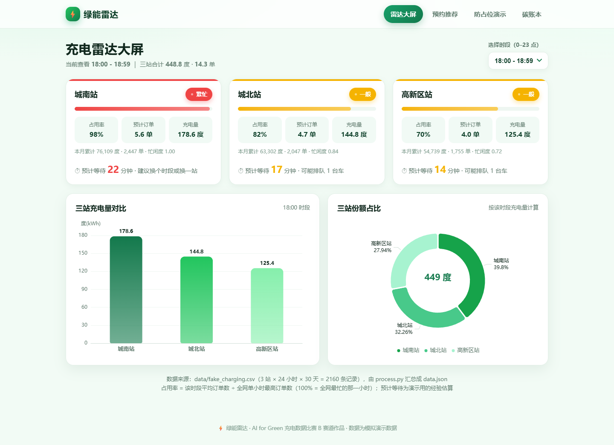
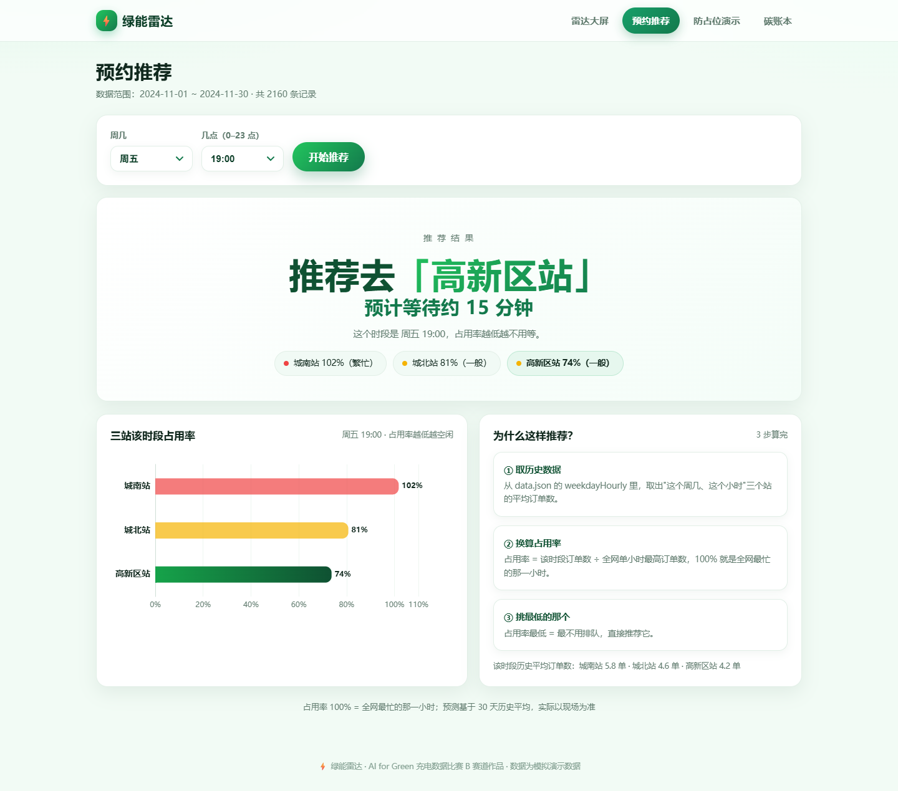
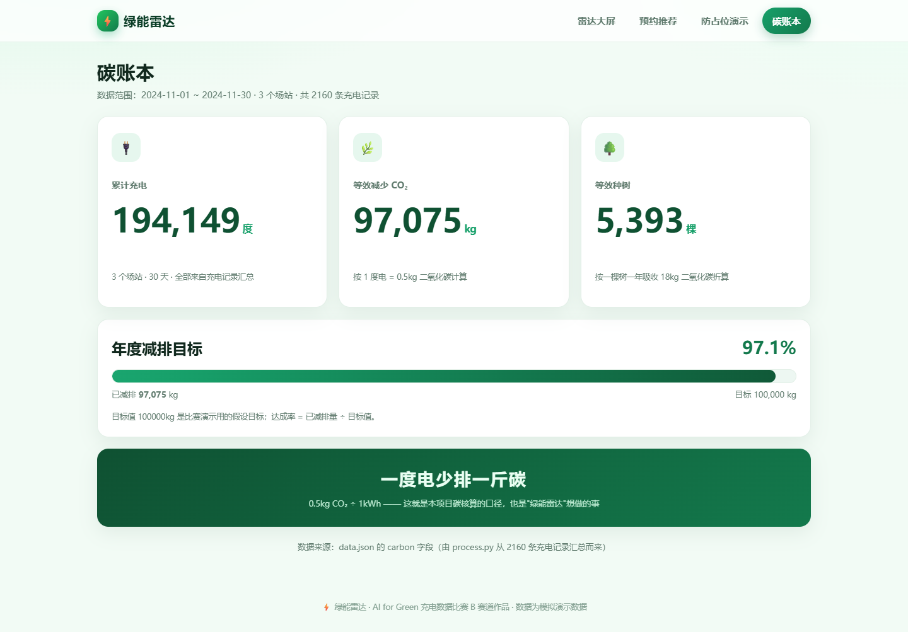

# ⚡ 绿能雷达（Green Radar）

> 把一份充电数据，变成"看得懂、用得上、还能算碳"的绿色出行工具。

**AI for Green 充电数据比赛 · B 赛道（开放创新）参赛作品**

线上体验地址：**<https://alien34144.github.io/green-radar/>**
（GitHub 仓库：<https://github.com/alien34144/green-radar>）

---

## 一、我们想解决什么问题

开电动车的人都有两个痛点：

1. **不知道哪个站现在不排队** —— 到了才发现要等半小时；
2. **充完电不挪车** —— 桩被"占着"，真正急需充电的人反而用不上。

「绿能雷达」用一份充电数据 + 4 个纯前端页面，把这两个问题拆开做：

| 问题 | 页面 | 做法 |
| --- | --- | --- |
| 现在哪站不排队？ | **雷达大屏** `index.html` | 选时段 → 三站忙闲红黄绿 + 预计等待 + 充电量对比图 |
| 我几点去、去哪站？ | **预约推荐** `recommend.html` | 选周几 + 几点 → 直接告诉你推荐去哪个站、大概等多久 |
| 占位怎么办？ | **防占位演示** `demo.html` | 宽限倒计时 + 接力预约 + 挪车加分/不挪扣分交互原型 |
| 到底减了多少碳？ | **碳账本** `carbon.html` | 累计充电 / 减排 CO₂ / 等效种树三个大数字 + 年度目标进度条 |

## 二、作品截图

| ① 雷达大屏 | ② 预约推荐 |
| --- | --- |
|  |  |

| ③ 碳账本 | ④ 防占位演示（弹窗状态） |
| --- | --- |
|  |  |

## 三、运行方法（只要两步）

需要本机装有 **Python 3**（其余什么都不用装，ECharts 已经下载到 `js/` 里了）。

```bash
# 第 1 步：把 CSV 数据加工成 data.json（网页唯一数据源）
python process.py

# 第 2 步：在项目目录起一个静态服务（端口可换）
python -m http.server 8000
```

然后浏览器打开 <http://localhost:8000/> 即可。

> ⚠️ 一定要用 `http://` 访问，**不要直接双击 html 文件**。
> 因为页面用 `fetch` 读取 `data.json`，浏览器的本地文件安全策略会拦掉 `file://` 下的请求。
> 如果打开页面看到红色提示条，说明 data.json 没读到，回来执行上面两步即可。

## 四、页面与文件结构

```
绿能雷达/
├── process.py              # 数据管道：CSV -> data.json（唯一的数据处理脚本）
├── data.json               # 网页唯一数据源（不要手改，改了会被 process.py 覆盖）
├── index.html              # ① 雷达大屏
├── recommend.html          # ② 预约推荐
├── demo.html               # ③ 防占位演示
├── carbon.html             # ④ 碳账本
├── css/style.css           # 全站统一样式（绿色主题）
├── js/echarts.min.js       # ECharts 图表库（已下载到本地，离线也能跑）
├── js/charts.js            # 共用画图函数 + 占用率/忙闲状态计算
├── js/recommend.js         # 预约推荐的业务逻辑
└── data/
    ├── fake_charging.csv   # 模拟充电数据（3 站 × 24 小时 × 30 天 = 2160 行）
    └── gen_fake_csv.py     # 生成上面这份 CSV 的脚本（固定随机种子，结果可复现）
```

## 五、数据是怎么来的（重要，评委可能会问）

- **`data/fake_charging.csv` 是模拟数据**，不是真实场站运营数据。
  由 `data/gen_fake_csv.py` 生成：3 个场站 × 24 小时 × 30 天 = **2160 行**，
  列名为 `日期,时间,场站,充电量kWh,订单数`。
  生成时按"城市通勤曲线"给了需求权重（傍晚 18–20 点最高、凌晨 3–5 点最低），
  再叠加地段差异（城南站最热）和 ±12% 随机波动，所以曲线看起来像真的。
- **页面里一个数字都不是手写的**，全部来自 `process.py` 对 CSV 的统计结果。
- **`process.py` 的统计口径**：
  - `hourly`：小时 → 场站 → **平均订单数**（30 天同一时刻取平均，代表"典型一天"）；
  - `hourlyKwh`：小时 → 场站 → 平均充电量（度）；
  - `weekdayHourly`：周几 → 小时 → 场站 → 平均订单数（预约推荐页用，比全天平均更准）；
  - `capacity`：每个场站**单小时最高**的平均订单数（描述"这个站自己最忙时有多忙"）；
  - `capacityGlobal`：**全网**单小时最高订单数，占用率的统一分母
    （如果各站用自己的峰值当分母，三个站在同一时刻都会算成 ~100%，大屏就全是红灯，看不出谁忙谁闲）；
  - `忙闲度`：该站总订单数 ÷ 三站中最大总订单数（1.0 = 最忙的站，显示在大屏卡片底部）；
  - `占用率`（页面显示）：该时段平均订单数 ÷ `capacityGlobal`，100% = 全网最忙的那一小时；
    颜色阈值：< 45% 空闲（绿）、< 85% 一般（黄）、其余繁忙（红）；
  - `预计等待`：`(占用率 - 0.2) × 28` 分钟，限制在 0–30 分钟，属**演示用经验估算**；
  - **碳数据**：减排 CO₂ = 总充电量 × **0.5kg/度**；等效种树 = 减排量 ÷ **18kg/棵/年**。
- `process.py` 会自动尝试 `utf-8-sig / gbk / gb18030` 等编码，所以把 Excel 另存的 CSV 丢进来也能读；
  空行、缺值、订单数写成字母的脏数据会被自动剔除（终端会打印剔除了多少行）。

> 换成真实数据时：只要 CSV 保持同样 5 个列名，执行 `python process.py` 就能全站更新，
> 4 个页面**一行代码都不用改**——这就是把数据处理单独放进 `process.py` 的原因。

## 六、技术栈

- 纯前端：**HTML + CSS + 原生 JavaScript**，没有框架、没有构建工具、没有后端服务
- 图表：**Apache ECharts 5.5.1**（已下载到 `js/echarts.min.js`，本地加载，不依赖 CDN）
- 数据管道：**Python 3 标准库**（`csv` + `json`，不装任何第三方包）
- 部署：**GitHub Pages** 静态托管

## 七、关于 AI 编程工具的使用声明

比赛要求如实说明开发方式，这里写清楚：

- 本项目**使用 AI 编程工具（DeepSeek Harness）辅助开发**：
  数据管道、4 个页面的代码与文案由 AI 按我们的需求分阶段生成初稿；
- 我们负责的是**需求定义、数据口径确认、逐页验收与修改**：
  每个阶段都实际运行验证（数据管道跑数、4 个页面的交互脚本验证）后才提交；
- 代码里保留了**完整中文注释**，方便团队内初学者阅读和二次修改；
- 所有数据口径（0.5kg/度、18kg/棵、占用率定义）都是我们自己确定并写进 README 的，
  AI 没有虚构任何数据字段。

## 八、排期与后续计划

- [x] 阶段 0：仓库与目录结构
- [x] 阶段 1：模拟数据 + 数据管道跑通
- [x] 阶段 2：4 页骨架 + 统一样式 + 本地 ECharts
- [x] 阶段 3：雷达大屏
- [x] 阶段 4：预约推荐
- [x] 阶段 5：碳账本
- [x] 阶段 6：防占位演示模板
- [x] 阶段 7：联调 + README + Pages 发布
- [ ] 队员 A 定制 `demo.html` 的视觉与动效（当前版本是能跑通的模板）
- [ ] 接入真实场站数据，替换 `data/fake_charging.csv`
- [ ] 雷达大屏增加 24 小时趋势折线图

## 九、本地验证记录

| 检查项 | 结果 |
| --- | --- |
| `python process.py` 生成 data.json | ✅ 2160 行 → 场站 3 个、小时 24 个、碳数据齐全 |
| GBK / UTF-8 文件自动识别 | ✅ 两种编码都能正确读取，脏数据自动剔除 |
| 4 个页面在 `python -m http.server` 下可访问 | ✅ 均返回 200 |
| 页面 JS 逻辑（卡片渲染 / 推荐结果 / 数字动画 / 弹窗交互） | ✅ 68 项断言全部通过 |
| 4 页导航互跳 | ✅ 高亮正确，无死链 |
| 浏览器控制台 | ✅ 无报错 |
| 线上 Pages 验收（从公网下载 11 个资源后重跑断言） | ✅ 全部 200，68 项断言通过，`data.json` 复算结果一致 |

---

项目定位：**一个月、三个场站、2160 条记录**的小样本验证。
我们想证明的不是"数据有多大"，而是"一份数据能不能真的帮车主少等 10 分钟、帮城市少排一吨碳"。
